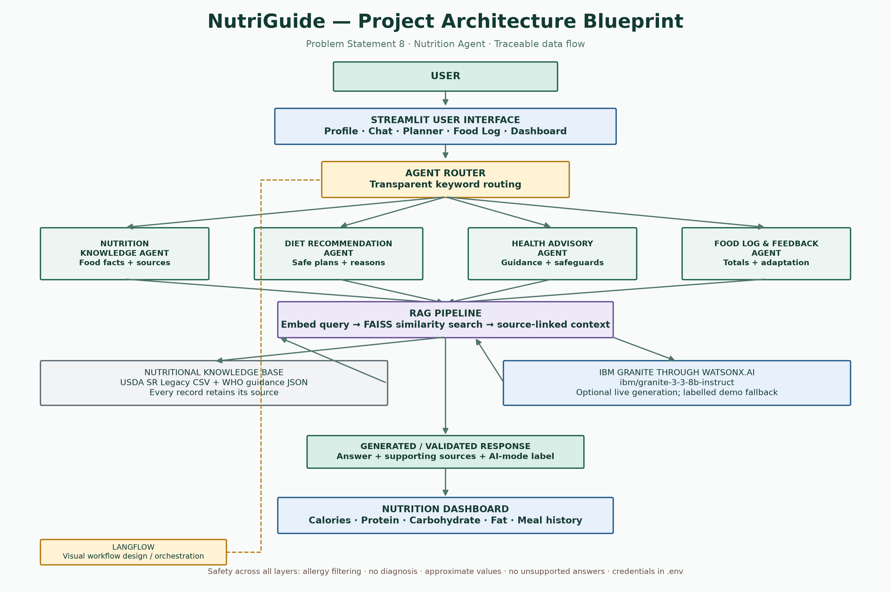

## GitHub Pages deployment (browser edition)

The repository root contains `index.html`, a static browser edition of NutriGuide. GitHub Pages can host this edition because it runs HTML, CSS and JavaScript in the visitor's browser. Its food explorer, template-based meal planner, nutrient calculations, browser-local food log and rule-based demonstration assistant work without a Python server.

**Important limitation:** GitHub Pages does not run `app.py`, Streamlit, Python packages, FAISS, or the IBM watsonx.ai SDK. The Pages edition is therefore a client-side demonstration and does not make live IBM Granite calls. Food-log entries and preferences are stored in the visitor's browser only. For the full Streamlit/Python experience, run `streamlit run app.py` on a Python host.

Published site (after the Pages deployment completes):  
https://ansariramish35-arch.github.io/NutriGuide-AI-Nutrition-Assistant/

Pages should publish the `main` branch from the repository root (`/(root)`). The `.nojekyll` marker keeps static project data and assets available to the browser app.

---

# NutriGuide – AI-Powered Personalized Nutrition Assistant

**IBM SkillsBuild University Engagement – AICTE 2026 · Problem Statement No. 8: Nutrition Agent**  
**Student:** Mohammad Ramish Ansari · B.Tech Computer Science Engineering (pursuing), University of Lucknow

NutriGuide is a beginner-friendly Streamlit proof of concept that combines a traceable USDA food subset, WHO educational guidance, a transparent keyword router, four task-specific functions, FAISS retrieval and optional IBM watsonx.ai / Granite generation. It demonstrates personalized meal filtering, nutrition calculations, manual food logging and a dashboard.

> **Important integration status:** The repository contains a real IBM watsonx SDK integration, but no credentials or live account verification were available during this build. Without your IBM credentials, the app runs in **DEMO MODE** using local rules and local TF-IDF + FAISS. This is not a successful Granite call. Confirm model/region availability in your own IBM account before presenting a live connection.

> **Health scope:** General nutrition education only. No diagnosis, disease-specific prescription, medication advice or replacement for a qualified clinician. Consult a doctor or registered dietitian for medical conditions, pregnancy, complex allergies or other individual needs.

## Contents

- [Features](#features)
- [Problem and objectives](#problem-and-objectives)
- [Technology stack](#technology-stack)
- [Architecture](#architecture)
- [Agents and routing](#agents-and-routing)
- [RAG in plain language](#rag-in-plain-language)
- [Data and calculations](#data-and-calculations)
- [Install and run](#install-and-run)
- [Connect IBM watsonx.ai](#connect-ibm-watsonxai)
- [LangFlow workflow](#langflow-workflow)
- [Screenshots and diagrams](#screenshots-and-diagrams)
- [Testing](#testing)
- [Limitations and responsible use](#limitations-and-responsible-use)
- [Project files](#project-files)
- [References](#references)

## Features

- Session-only profile: age, diet preference, goal, declared allergies, cuisine and activity level; an allergy mentioned only in chat prompts users to add it to the profile before planning.
- Searchable 28-food USDA SR Legacy subset with FDC IDs, source URL, per-100-g values and reference servings.
- Food value explorer and natural-language nutrition lookup.
- Four-slot meal templates with diet, allergy, cuisine and availability filtering before nutrient calculations.
- Feedback actions for variety and smaller portions; smaller portions scale and recalculate all meal components.
- Add, update and remove food-log servings; visible declared-allergen warnings.
- Interactive calorie, protein, carbohydrate and fat dashboard with history and explicitly educational targets.
- Retrieval-Augmented Generation using local TF-IDF embeddings with a FAISS index; optionally IBM Slate embeddings.
- Optional IBM Granite generation through IBM's `ibm-watsonx-ai` SDK; offline answers are visibly labelled as demonstration answers.
- Source links shown with retrieved answers and food facts.

## Problem and objectives

The official PS8 describes the difficulty people face in finding personalized nutrition guidance that considers lifestyle, culture, preferences and changing feedback; it proposes an interactive nutrition assistant. NutriGuide addresses a modest, feasible subset: clear source-linked food facts, allergy-filtered meal suggestions, explainable calculations and editable food tracking. It does **not** implement the full problem-statement vision of voice/image input or medical-condition-specific plans.

## Technology stack

| Technology | Use in this prototype |
|---|---|
| Python | Small readable functions and nutrient calculations |
| Streamlit | Profile, chat, planner, logger, dashboard, navigation |
| pandas | Load and summarize the CSV food data and log tables |
| Plotly | Intake-to-reference chart |
| scikit-learn TF-IDF | Free/local text embeddings in demonstration mode |
| FAISS | Similarity search over food/guidance documents |
| IBM watsonx.ai / Granite | Optional live grounded text generation using `ibm/granite-3-3-8b-instruct` |
| IBM Slate embeddings | Optional `ibm/slate-30m-english-rtrvr` embeddings; account access must be confirmed |
| LangFlow | Visual workflow design provided as a node/edge manifest and diagram; Streamlit currently executes equivalent Python functions directly |
| USDA / WHO | Traceable food composition and general healthy-diet references |

## Architecture



Data flow: **User → Streamlit UI → keyword Agent Router → one task-specific function → RAG retrieval over CSV/JSON → validated safe draft and source references → optional Granite wording → response → session food log/dashboard.** Local calculators and allergy filters remain deterministic; Granite is not allowed to invent numbers or add a food to a filtered meal.

The `assets/architecture.svg` copy can be enlarged without losing resolution.

## Agents and routing

These four components are **function-based, task-specific agents** coordinated by a simple keyword router. They are not fully autonomous systems that independently plan, learn, or call arbitrary tools.

1. **Nutrition Knowledge Agent** (`agents/nutrition_agent.py`): looks up food facts and returns both reference-serving and per-100-g values with an FDC source.
2. **Diet Recommendation Agent** (`agents/diet_agent.py`): selects existing meal templates only after every ingredient passes diet, declared-allergy, cuisine and availability checks; computes every nutrient from CSV values.
3. **Health Advisory Agent** (`agents/advisory_agent.py`): provides general WHO-linked preventive guidance, simple swaps and safety referrals; rejects unsupported retrieval context.
4. **Food Log & Feedback Agent** (`agents/food_log_agent.py`): adds, updates, removes entries, totals nutrients, flags a logged declared allergen and compares intake with educational references.

`agents/router.py` chooses a task by straightforward keyword rules. Open `About Project` in the app for a more detailed explanation and current IBM configuration status.

## RAG in plain language

RAG means **Retrieval-Augmented Generation**. Think of it as looking up the class notes before writing an answer:

1. Build readable documents from food rows and WHO guidance.
2. Convert each text to a numeric representation (local TF-IDF, or optional IBM Slate embeddings).
3. Put vectors into a FAISS index.
4. Convert a question to a vector and find similar documents.
5. Give the retrieved records and a safe, already-calculated draft to Granite (only if credentials are configured).
6. Display the answer and its source link.

If no relevant material is retrieved, the application says the small dataset did not verify the answer. It does not claim to query a live USDA database.

## Data and calculations

`data/foods.csv` is a selected subset of 28 records from the **USDA FoodData Central SR Legacy April 2018** archive. It stores FDC IDs, source URLs, per-100-g calories/macros/fibre/selected micronutrients and declared reference serving weights. It is a static dataset, not live food data. `data/guidance.json` contains a small set of WHO general guidance. `data/substitutions.json` and `data/meal_templates.json` support app behavior and are not additional measured food-value data.

For nutrient value `V` per 100 g and serving weight `W` grams:

`nutrient per serving = V × W / 100`

A logged amount with `n` servings uses `V × W / 100 × n`. Calculations round for display. Recipes, oils, beverages and ingredients not added separately are not included. Brand and preparation differences matter.

Dashboard references start with an educational 2,000 kcal / 50 g protein example and make small transparent goal/activity adjustments. These are **not** BMR/TDEE estimates, personalised clinical prescriptions or suitable targets for every user. They exist to demonstrate dashboard progress.

## Install and run

### Windows (PowerShell)

1. Install Python 3.10–3.13 from [python.org](https://www.python.org/downloads/). During installation, select **Add Python to PATH**.
2. Download/clone the project folder and open PowerShell in it.
3. Create a virtual environment:

   ```powershell
   py -3.12 -m venv .venv
   .\.venv\Scripts\Activate.ps1
   ```

   If PowerShell blocks activation, use `Set-ExecutionPolicy -Scope Process Bypass`, then activate again.
4. Install dependencies:

   ```powershell
   python -m pip install --upgrade pip
   pip install -r requirements.txt
   ```
5. Start the app:

   ```powershell
   streamlit run app.py
   ```

6. Open the local URL printed by Streamlit (normally `http://localhost:8501`). With no IBM secrets, all local demo functionality should still be available.

### macOS / Linux

```bash
python3 -m venv .venv
source .venv/bin/activate
python -m pip install --upgrade pip
pip install -r requirements.txt
streamlit run app.py
```

The first run constructs the small FAISS index in memory. No vector database service or external API is necessary in local demo mode. Allow about 1–2 minutes for dependencies on a typical connection.

## Connect IBM watsonx.ai

1. Create/sign in to IBM Cloud and provision or open a watsonx.ai project with model access. Lite entitlements, quotas, regions and currently available models are account-dependent.
2. In the project, create/copy the IBM Cloud API key and project ID privately. Never paste them into source files, screenshots, chat logs, or a public Git repository.
3. Copy `.env.example` to `.env` in the project root.
4. Set `WATSONX_API_KEY`, `WATSONX_PROJECT_ID`, and the correct region `WATSONX_URL`. Confirm that your project can access the configured `WATSONX_MODEL_ID` (`ibm/granite-3-3-8b-instruct`) and optionally `WATSONX_EMBEDDING_MODEL_ID` (`ibm/slate-30m-english-rtrvr`). A model shown in general IBM documentation is not proof of access in your account/region.
5. Keep `RAG_EMBEDDING_PROVIDER=local` for local TF-IDF or set `watsonx` to attempt IBM Slate embeddings. The latter needs current SDK compatibility, permissions and quota.
6. Restart Streamlit. The sidebar/About page shows only non-secret configuration. Use **Test live IBM Granite connection** for one real request; this may use account quota.
7. A response marked **Live IBM Granite response** means the SDK returned a response. If it fails and fallback is enabled, the app explicitly marks the answer **DEMO FALLBACK**. Disable fallback with `ALLOW_OFFLINE_FALLBACK=false` if you prefer an error rather than a local draft.

Do not claim a live Granite or IBM embedding request unless you actually made it in your account. `config.py` never displays the API key.

### Upload to GitHub (after creating your own empty repository)

The project is prepared locally; no GitHub repository has been created and no URL is claimed. First create a repository under your own account, then replace `YOUR-USERNAME` below with the exact owner/account slug shown by GitHub:

```bash
cd NutriGuide-AI-Nutrition-Assistant
git init -b main
git add .
git status   # review staged files; ensure .env, resumes and standalone certificates are absent
git commit -m "Initial NutriGuide project"
git remote add origin https://github.com/YOUR-USERNAME/NutriGuide-AI-Nutrition-Assistant.git
git push -u origin main
```

Do not push a `.env` file, API key, full resume or standalone certificate. The requested deck embeds the two certificate visuals; review that choice before making a public repository if you prefer not to publish them.

## LangFlow workflow

- Visual diagram: `assets/langflow_workflow.png` and `.svg`.
- Workflow description: `langflow/workflow.json` (node/edge manifest and component setup notes).
- Explanation: `langflow/README.md`.

LangFlow's import JSON schema varies by release. The supplied file is a transparent workflow manifest, not a claim of verified native import into every LangFlow version. Create the listed nodes in your installed LangFlow UI (Chat Input, custom Python/router, File, Split Text, embeddings, FAISS, Retriever, Prompt, watsonx model, Chat Output) and connect as the diagram indicates. The currently tested Streamlit app performs equivalent routing/RAG in Python; it does not call a LangFlow server. Optional installation is isolated in `requirements-langflow.txt` because LangFlow is a much larger stack.

## Screenshots and diagrams

See `assets/architecture.png`, `assets/langflow_workflow.png`, and genuine captures from the running local Streamlit instance: `assets/app_home.png`, `assets/app_food_logger.png` and `assets/app_dashboard.png`. The dashboard capture uses the app's sample log. Diagrams are labelled diagrams, not app screenshots.

## Testing

Install the optional development tools and run:

```bash
pip install -r requirements-dev.txt
pytest -q
```

The included tests cover food math, vegetarian/high-protein breakfast filtering, four meal slots, add/update/remove logging, source-backed banana lookup, declared allergy filtering, food swaps, out-of-dataset abstention, empty dashboard and medical safety routing. See `docs/testing_report.md` for the actual execution result and test inventory. The test suite does not prove your IBM credentials/model access or every browser interaction.

## Limitations and responsible use

- Prototype dataset contains 28 foods, not all foods or brands; data is static from an older SR Legacy release.
- Serving sizes represent the dataset's declared reference, not a guarantee of a user's portion.
- Meal templates are small illustrative recipes; omitted ingredients do not contribute to totals.
- Profile, chat and food logs live in Streamlit session state only and are not persisted for accounts.
- Keyword routing is simple and can misroute ambiguous wording.
- The optional Granite model and IBM embeddings were not live-tested in this build; confirm model, region, quota and SDK compatibility.
- No voice/image food recognition, disease-specific diets, medical diagnosis, prescription, wearable or multilingual features are implemented.
- Reported progress targets are educational UI references, not medically approved personal goals.
- For medical conditions, pregnancy-related needs, eating disorders, complex allergies or children, consult a qualified professional.

## Project files

| File/folder | Purpose |
|---|---|
| `app.py` | Streamlit pages, session UI, charts and response display |
| `agents/` | Shared calculators and four routed functions |
| `rag/` | FAISS index, document preparation and IBM Granite client |
| `data/foods.csv` | Traceable USDA-derived subset |
| `data/guidance.json` | Source-linked general WHO guidance |
| `data/meal_templates.json` | Filterable meal components |
| `data/substitutions.json` | Modest food swaps and safety constraints |
| `tests/` | Executable pytest suite |
| `langflow/` | Workflow manifest and import guidance |
| `assets/` | Project diagrams and genuine app screenshots when captured |
| `docs/` | Testing report, viva guide and two-minute demo script |
| `yourproblemstatement.pdf` | Official PS8 excerpt with project copy |
| `projectpresentation.pptx` | Presentation built to mirror the supplied 16-page PDF template's order and minimal style |
| `requirements.txt` / `requirements-dev.txt` | Runtime packages and optional test/document-generation tools |
| `.env.example` / `app.json` | Safe configuration guide and deployment metadata |

## References

- USDA FoodData Central: [food composition database](https://fdc.nal.usda.gov/) and [download datasets](https://fdc.nal.usda.gov/download-datasets/) (SR Legacy, April 2018).
- World Health Organization: [Healthy diet](https://www.who.int/news-room/fact-sheets/detail/healthy-diet).
- IBM: [watsonx.ai foundation model reference](https://dataplatform.cloud.ibm.com/docs/content/wsj/analyze-data/fm-models.html) (availability must be checked in your own project/region).
- Official uploaded AICTE problem statement and project guidelines are included in the submission context; see `yourproblemstatement.pdf` for the relevant PS8 wording.
